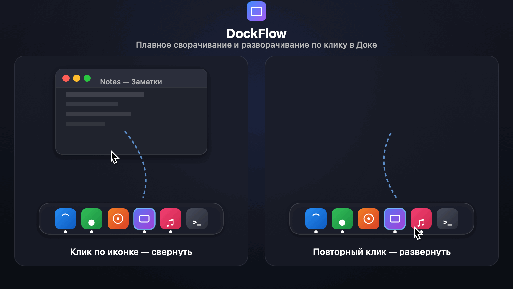
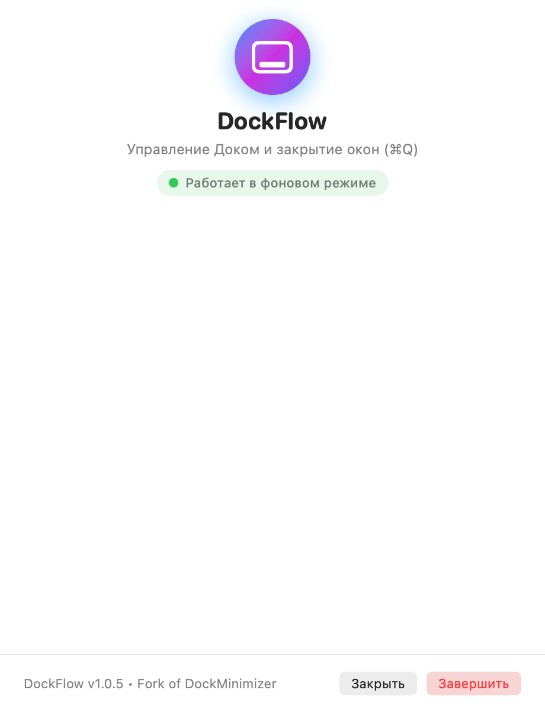
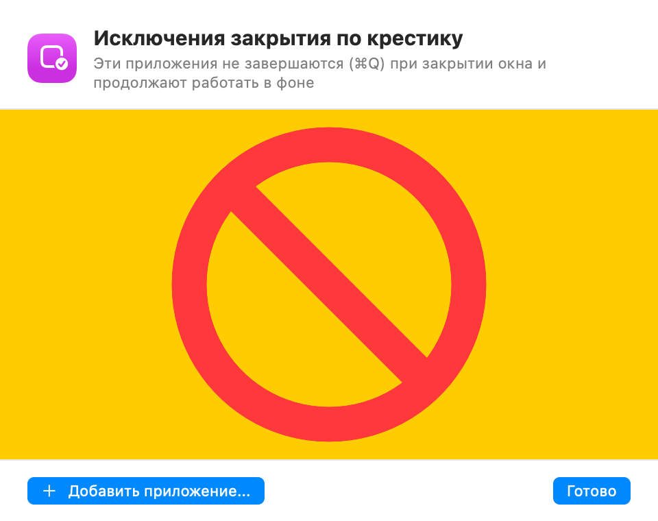

# 🌊 DockFlow for macOS

> **Плавное управление Доком, умное закрытие окон (⌘Q) и новые жесты в стиле macOS.**  
> *Эффект Джинна по клику на Док, завершение по красному крестику с сохранением сессий, клик колёсиком мыши, список исключений и тактильный отклик.*

  
  
  
  
  

> 🔱 **О проекте и авторстве / Attribution:**  
> **DockFlow** является глубоко переработанным форком проекта **[DockMinimizer](https://github.com/JackTonyMa/DockMinimizer)** разработчика *JackTonyMa*.  
> В форке полностью переосмыслено поведение окон, добавлены аппаратная анимация Джинна, модуль автозавершения через CoreGraphics, список исключений, поддержка клика колёсиком (Middle Click), тактильная отдача (Haptic Feedback), нулевое потребление ЦП (0.0%), сохранение сессий браузеров и интерфейс в стиле macOS 27.

---

  <b>🇷🇺 Русский</b> &nbsp;&nbsp;&nbsp;&nbsp; | &nbsp;&nbsp;&nbsp;&nbsp; <a href="README_en.md"><b>🇺🇸 English</b></a>

---

  

  

  

    
<b>📸 Скриншоты окна настроек и исключений (Нажмите, чтобы развернуть)</b>

     
    

      
      &nbsp;&nbsp;&nbsp;&nbsp;
      
    

  

### 📌 Почему DockFlow?

В стандартной macOS есть привычные особенности оконного менеджера, к которым сложно привыкнуть (особенно после Windows):
1. **Клик по Доку не сворачивает окно:** Если приложение уже активно, повторный клик по его иконке в Доке ничего не делает.
2. **Красный крестик не закрывает программу:** Нажатие на крестик лишь закрывает окно, оставляя фоновый процесс висеть в памяти и в Доке с точкой, требуя постоянного нажатия `⌘ + Q`.
3. **Мессенджеры и плееры:** При закрытии окна часто хочется закрыть браузер насовсем, но оставить Telegram или Музыку в фоне.

**DockFlow** элегантно и бесшовно решает эти задачи на системном уровне, не расходуя батарею (**0.0% CPU в режиме ожидания**).

---

### 🚀 Возможности DockFlow

| Возможность | Описание |
|---|---|
| 🪄 **Эффект Джинна (Genie)** | Повторный клик по активному приложению в Доке плавно сворачивает его с анимацией Джинна, следующий клик — разворачивает. |
| ❌ **Закрытие по крестику (⌘Q)** | Нажатие на красный крестик последнего окна завершает приложение целиком, как по `Command + Q`. |
| 🛡️ **Список исключений** | Telegram, Discord, Spotify, Музыка или любые выбранные вами приложения остаются работать в фоне. |
| 🖱️ **Клик колёсиком (Middle Click)** | Нажатие средней кнопкой мыши по Доку открывает **новое окно (⌘N)**, завершает (⌘Q) или скрывает приложение. |
| 📳 **Тактильный отклик (Haptic)** | Физический виброотклик трекпада Force Touch / Magic Trackpad при сворачивании и закрытии окон. |
| 🌐 **Мультиязычность** | Полная локализация интерфейса: Русский, English, 简体中文 (Китайский) и Українська. |
| 🔋 **0.0% CPU в фоне** | Полностью реактивная архитектура без постоянных таймеров — нулевой расход батареи и полная поддержка App Nap. |
| 💾 **Сохранение вкладок** | Браузеры (Safari, Chrome и др.) сохраняют открытые вкладки и сессии при закрытии по крестику. |
| 🔄 **OTA автообновление** | Встроенное обновление приложения прямо из менюбара с отображением прогресса в реальном времени. |

---

### 📦 Установка

1. Скачайте **`DockFlow-Installer.dmg`** из раздела [Releases](https://github.com/minosssh1/DockFlow/releases).
2. Откройте образ и перетащите **DockFlow** в папку **Applications**.
3. Запустите приложение.
4. При первом запуске выдайте разрешение в:  
   `Системные настройки → Конфиденциальность и безопасность → Универсальный доступ`.

---

### 📄 Лицензия

Распространяется под лицензией **MIT**. Оригинальный проект Copyright © 2025 JackTonyMa. Улучшения форка Copyright © 2026.
