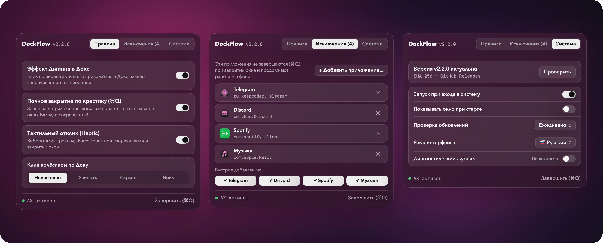
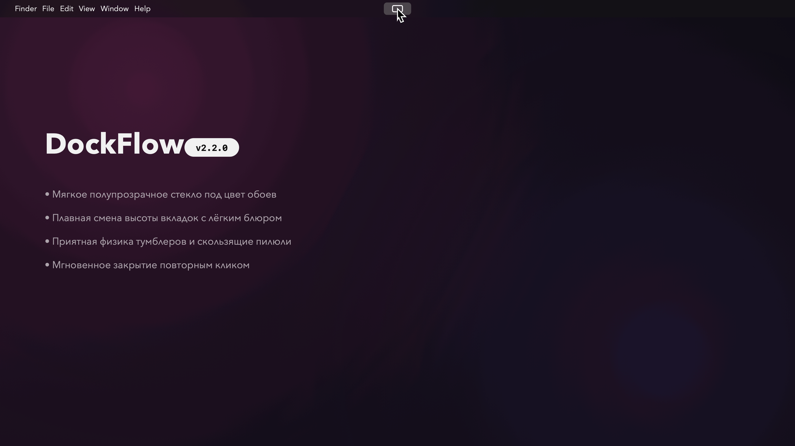
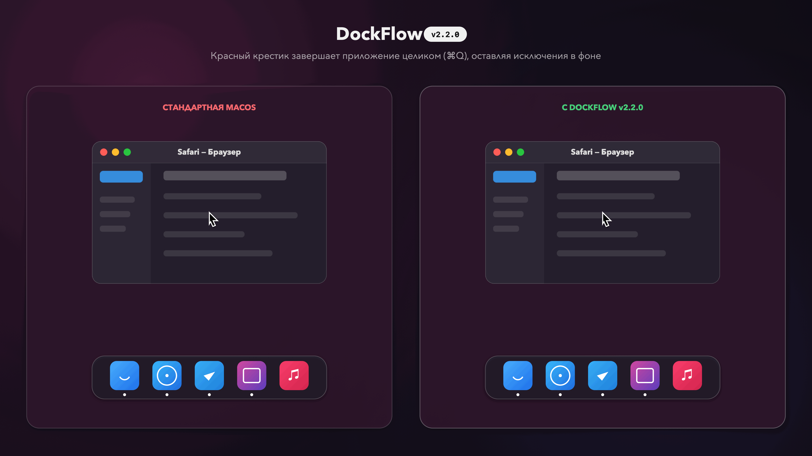
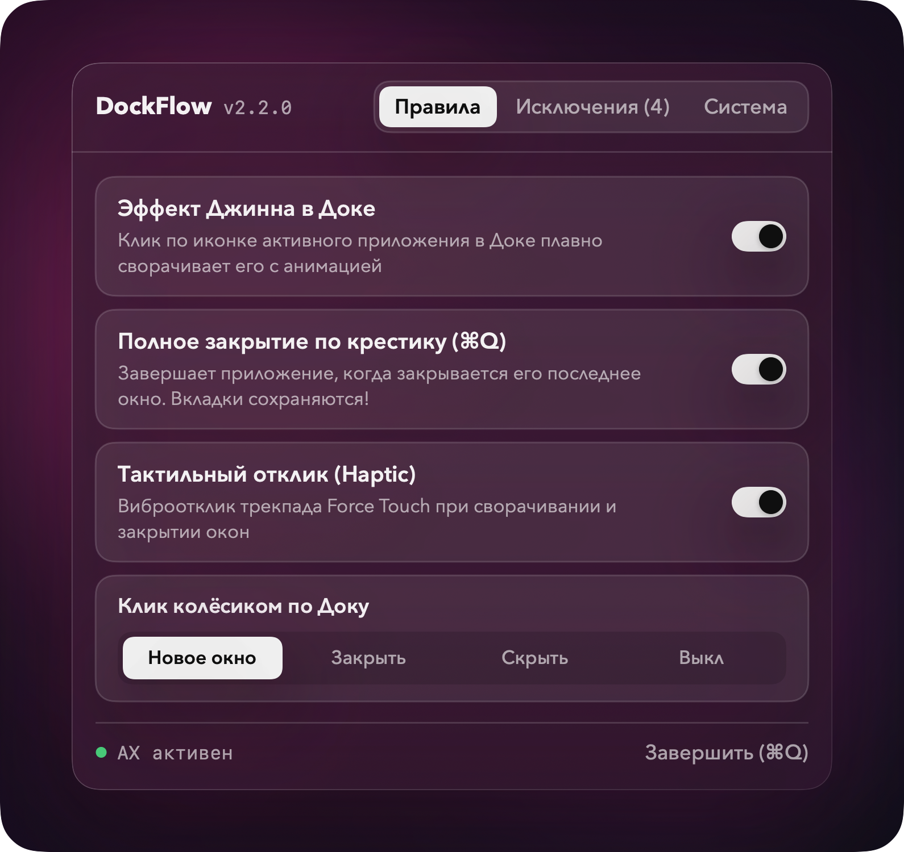
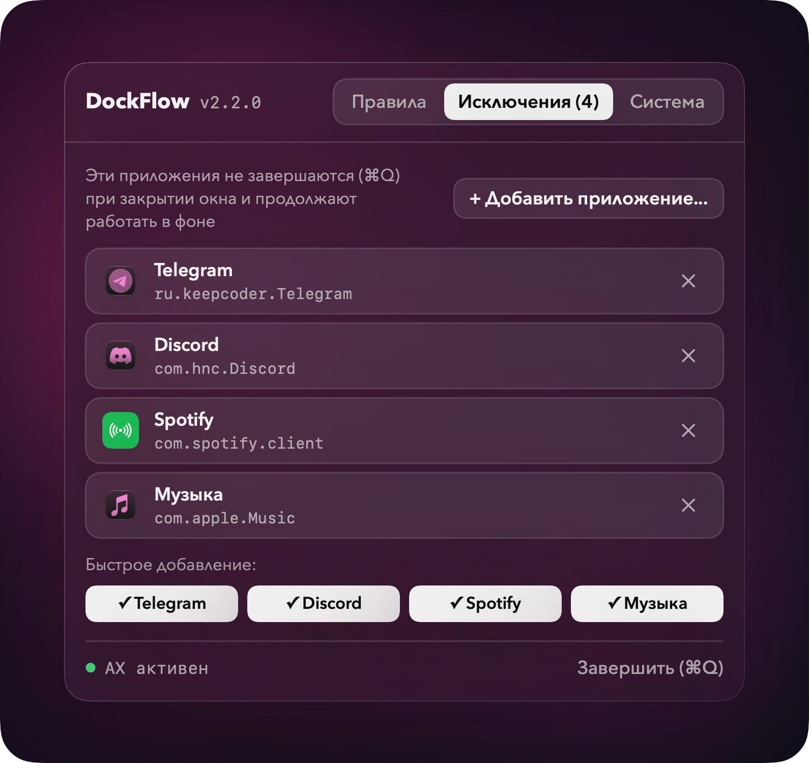
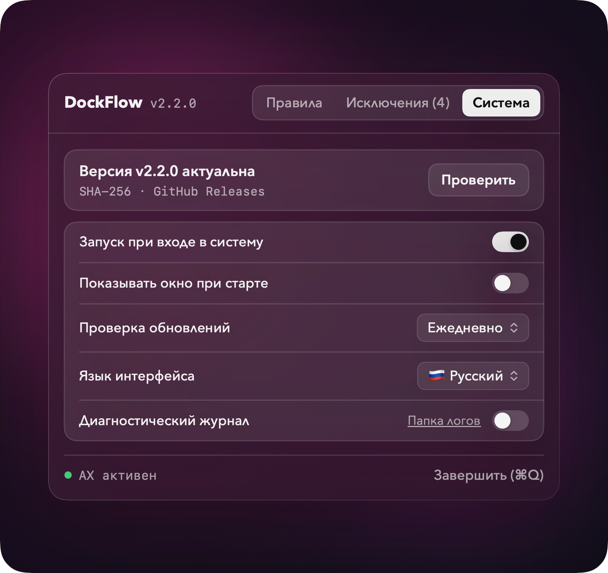

# 🌊 DockFlow for macOS

**Плавное управление Доком, умное закрытие окон (`⌘Q`) и живой интерфейс в стиле матового стекла.**

 

  
  
  
  
  
  

  <b>🇷🇺 Русский</b> &nbsp;&nbsp;·&nbsp;&nbsp; <a href="README_en.md"><b>🇺🇸 English</b></a>

 

 

> 🔱 **О проекте и авторстве:**  
> **DockFlow** — глубоко переработанный форк **[DockMinimizer](https://github.com/JackTonyMa/DockMinimizer)** от *JackTonyMa*.  
> Создан и развивается **[@minosssh1](https://github.com/minosssh1)** совместно с **Antigravity** (Google DeepMind): нативное управление окнами без фоновой нагрузки на процессор (`0.0% CPU`), аппаратный эффект Джинна, умное завершение процессов с сохранением вкладок, белый список исключений и полупрозрачный интерфейс в духе macOS.

---

### ✨ В действии (`1080p`)

#### 1. Живой интерфейс и плавные переходы
*Полупрозрачное стекло под цвет обоев, плавная смена высоты вкладок и приятный отклик элементов*
  

  

#### 2. Эффект Джинна в Доке
*Повторный клик по активному приложению в Доке плавно сворачивает и разворачивает окно*
  

  

#### 3. Полное закрытие (`⌘Q`) и исключения
*Красный крестик завершает программу целиком с сохранением вкладок, а мессенджеры и плееры продолжают работать в фоне*
  

<b>📸 Скриншоты всех вкладок по отдельности (нажмите, чтобы открыть)</b>

 

  
  &nbsp;
  
  &nbsp;
  

---

### 📌 Зачем нужен DockFlow?

В macOS работа с окнами часто требует лишних действий — особенно если вы привыкли к логике Windows или хотите меньше рутины:

1. **Клик по иконке в Доке не сворачивает окно:** если программа уже на переднем плане, повторный клик по ней ничего не делает.
2. **Красный крестик не закрывает приложение:** окно исчезает, но процесс и точка под иконкой остаются в памяти до явного `⌘ + Q`.
3. **Исключения для фоновых программ:** браузеры и редакторы удобно закрывать полностью, но `Telegram`, `Discord`, `Spotify` или `Музыка` должны спокойно оставаться в фоне.

---

### 🚀 Возможности v2.2.0

| Возможность | Описание |
|---|---|
| 🪟 **Живое матовое стекло** | Полупрозрачная панель из строки меню мягко подстраивается под цвета обоев и окон позади, с плавным появлением и изменением высоты между вкладками. |
| 🪄 **Эффект Джинна в Доке** | Клик по активному приложению в Доке сворачивает окно с анимацией, следующий клик — возвращает обратно. |
| ❌ **Закрытие по крестику (`⌘Q`)** | При закрытии последнего окна программа завершается полностью, освобождая память. |
| 🛡️ **Список исключений** | Быстрое добавление в 1 клик (`Telegram`, `Discord`, `Spotify`, `Музыка`) или выбор любых приложений с диска. |
| 🖱️ **Клик колёсиком по Доку** | Настраиваемое действие на среднюю кнопку мыши: **Новое окно (`⌘N`)**, **Закрыть (`⌘Q`)**, **Скрыть (`⌘H`)** или **Выкл**. |
| 📳 **Тактильный отклик (Haptic)** | Мягкий виброотклик трекпада Force Touch при сворачивании и закрытии окон. |
| 💾 **Сохранение сессий** | Браузеры (`Safari`, `Chrome` и др.) корректно запоминают открытые вкладки перед выходом. |
| 🔄 **Автообновление в приложении** | Проверка новых релизов на GitHub с автоматической проверкой контрольной суммы `SHA-256`. |
| 🌐 **4 языка и 0.0% CPU** | Русский, English, 简体中文, Українська. Событийная архитектура без фоновых опросов не тратит заряд батареи. |

---

### 📦 Установка

1. Скачайте **`DockFlow-Installer.dmg`** в разделе [Releases](https://github.com/minosssh1/DockFlow/releases).
2. Откройте образ и перетащите **DockFlow** в папку **Программы (Applications)**.
3. Запустите приложение — иконка появится в верхней строке меню.
4. При первом запуске выдайте разрешение в:  
   `Системные настройки → Конфиденциальность и безопасность → Универсальный доступ`.

---

### 📄 Лицензия и благодарности

- **Оригинальный проект:** Copyright © 2025 **[JackTonyMa](https://github.com/JackTonyMa)** (*DockMinimizer*).
- **DockFlow:** Copyright © 2026 **[minosssh1](https://github.com/minosssh1)** · Разработано совместно с **Antigravity** (Google DeepMind).
- Лицензия: **MIT License**.
