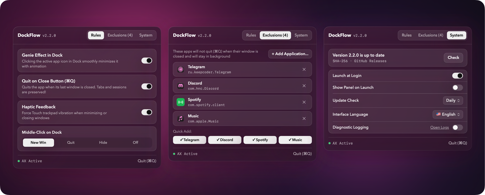
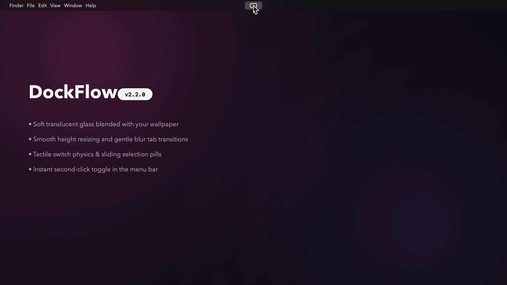
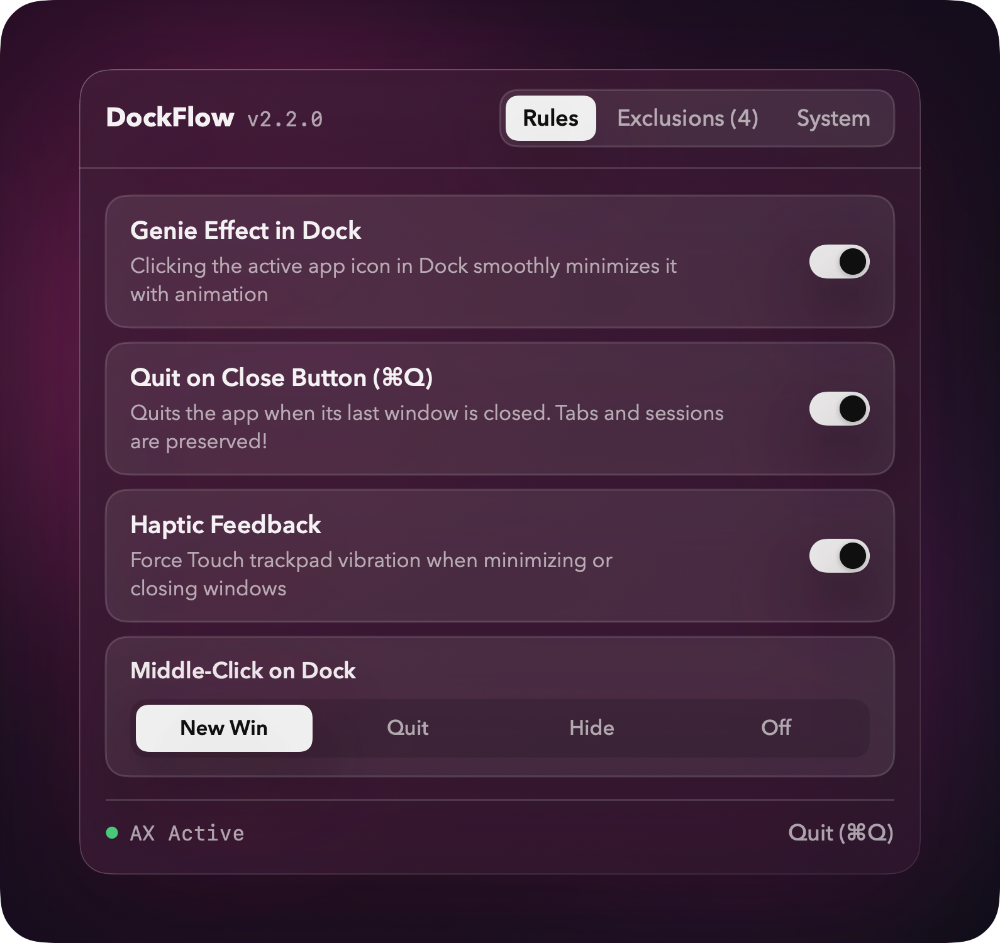
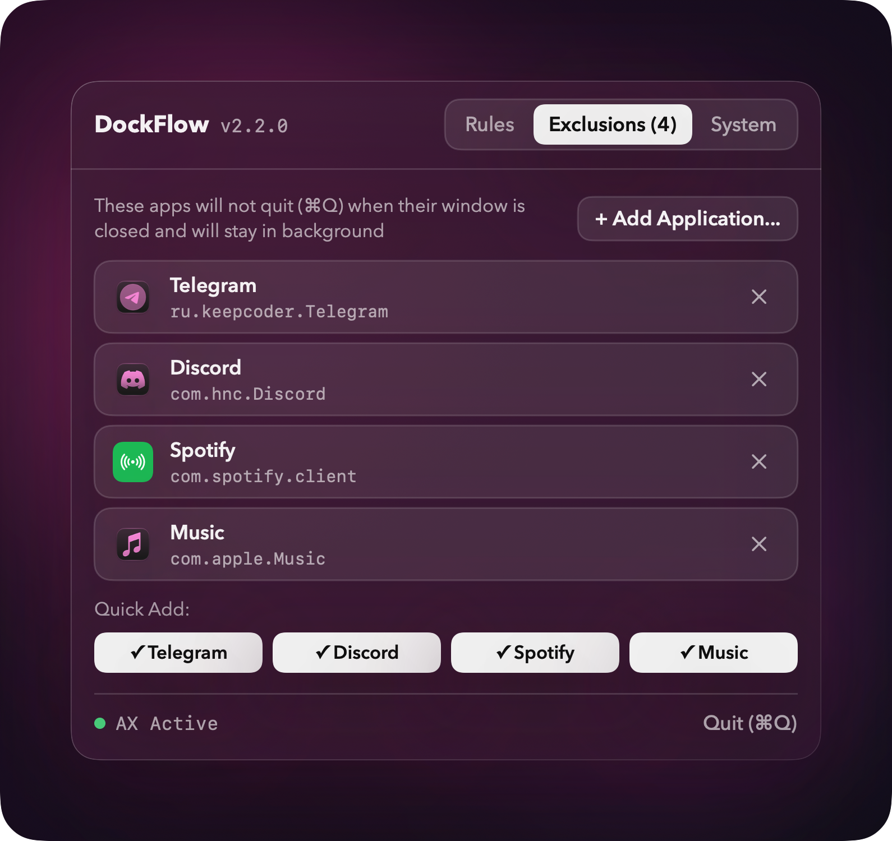
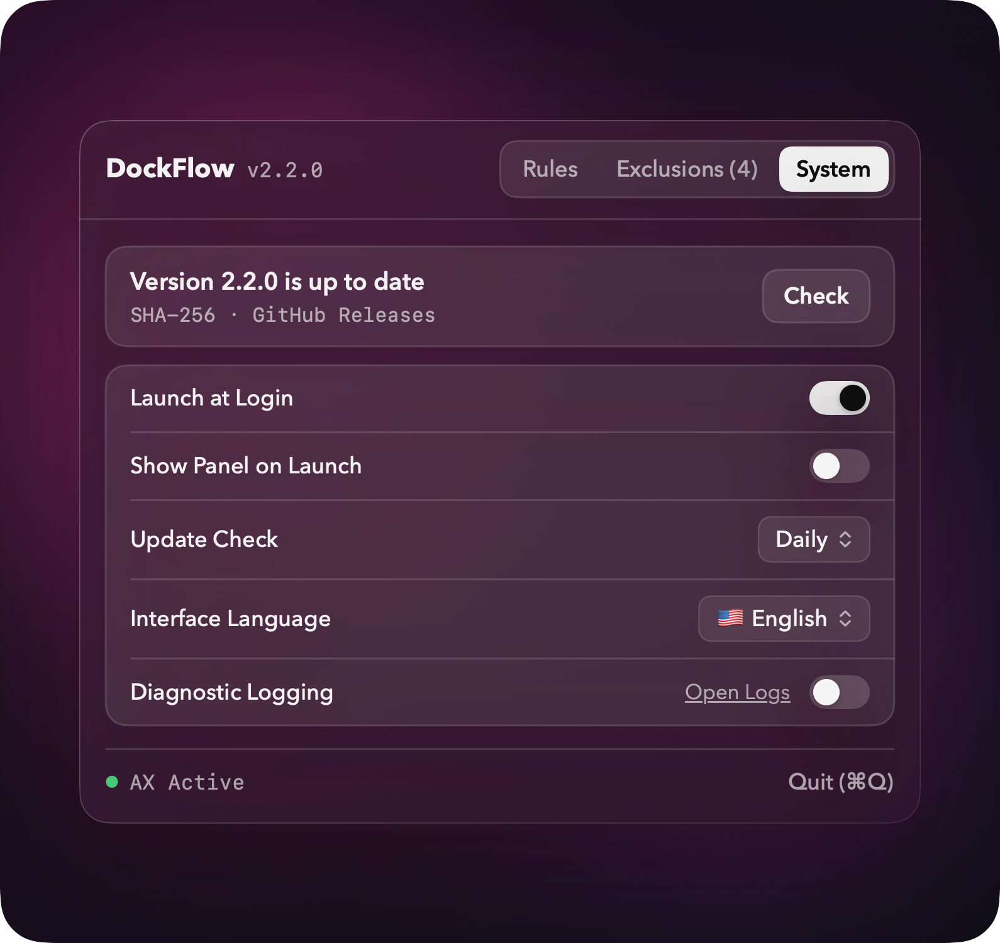

# 🌊 DockFlow for macOS

**Smooth Dock window management, smart quit-on-close (`⌘Q`), and a soft frosted glass interface.**

 

  
  
  
  
  
  

  <a href="README.md"><b>🇷🇺 Русский</b></a> &nbsp;&nbsp;·&nbsp;&nbsp; <b>🇺🇸 English</b>

 

 

> 🔱 **Attribution & Origin:**  
> **DockFlow** is a deeply redesigned fork of **[DockMinimizer](https://github.com/JackTonyMa/DockMinimizer)** by *JackTonyMa*.  
> Built and maintained by **[@minosssh1](https://github.com/minosssh1)** together with **Antigravity** (Google DeepMind) — featuring native Dock click-to-minimize, smart quit-on-close with session preservation, an app exclusions whitelist, middle-click gestures, Force Touch haptics, `0.0%` idle CPU usage, and a clean translucent glass UI.

---

### ✨ In Motion (`4K`)

#### 1. Soft Frosted UI & Smooth Transitions
*Translucent backdrop that gently adapts to your wallpaper, silky tab height transitions, and crisp spring controls*
  

  

#### 2. Genie Effect on Dock Click
*Clicking an active app icon in the Dock smoothly minimizes its window; clicking again restores it*
  

  

#### 3. Smart Quit on Close (`⌘Q`) & Exclusions
*Closing the last window quits heavy apps cleanly while preserving browser tabs — messengers stay running in background*
  

<b>📸 Individual Tab Screenshots (Click to expand)</b>

 

  
  &nbsp;
  
  &nbsp;
  

---

### 📌 Why DockFlow?

macOS handles windows differently from what many desktop users expect:

1. **Dock clicks don't minimize active windows:** clicking the icon of an already focused app does nothing.
2. **The red close button doesn't quit the app:** closing the last window leaves the process and its Dock indicator running in memory until you press `⌘ + Q`.
3. **Different rules for different apps:** you want browsers and utilities to quit cleanly, while keeping `Telegram`, `Discord`, `Spotify`, or `Music` alive in the background.

---

### 🚀 Highlights in v2.2.0

| Feature | Description |
|---|---|
| 🪟 **Translucent Glass Panel** | Floating menu bar panel gently blends wallpaper colors underneath, with smooth fade-and-blur tab transitions and dynamic height resizing. |
| 🪄 **Genie Effect in Dock** | Clicking an active Dock icon minimizes the window smoothly; clicking again brings it back. |
| ❌ **Quit on Close (`⌘Q`)** | Closing an app's last window terminates the app cleanly without extra shortcuts. |
| 🛡️ **Exclusions Whitelist** | One-click presets (`Telegram`, `Discord`, `Spotify`, `Music`) or pick any app to keep running in the background. |
| 🖱️ **Middle-Click on Dock** | Customize middle-click per action: **New Window (`⌘N`)**, **Quit (`⌘Q`)**, **Hide (`⌘H`)**, or **Off**. |
| 📳 **Force Touch Haptics** | Subtle physical trackpad feedback when minimizing or quitting windows. |
| 💾 **Tab & Session Preservation** | Browsers (`Safari`, `Chrome`, etc.) preserve open tabs and session states on quit. |
| 🔄 **In-App Updates** | Built-in GitHub Releases updater with automatic `SHA-256` checksum verification. |
| 🌐 **4 Languages & 0.0% Idle CPU** | English, Русский, 简体中文, and Українська. Event-driven engine uses zero background polling. |

---

### 📦 Installation

1. Download **`DockFlow-Installer.dmg`** from [Releases](https://github.com/minosssh1/DockFlow/releases).
2. Open the DMG and drag **DockFlow** to **Applications**.
3. Launch DockFlow from Applications — its icon appears in your menu bar.
4. Grant the required permission when prompted:  
   `System Settings → Privacy & Security → Accessibility`.

---

### 📄 License & Credits

- **Original project:** Copyright © 2025 **[JackTonyMa](https://github.com/JackTonyMa)** (*DockMinimizer*).
- **DockFlow:** Copyright © 2026 **[minosssh1](https://github.com/minosssh1)** · Crafted with **Antigravity** (Google DeepMind).
- Distributed under the **MIT License**.
