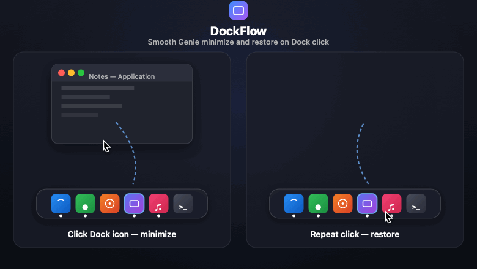
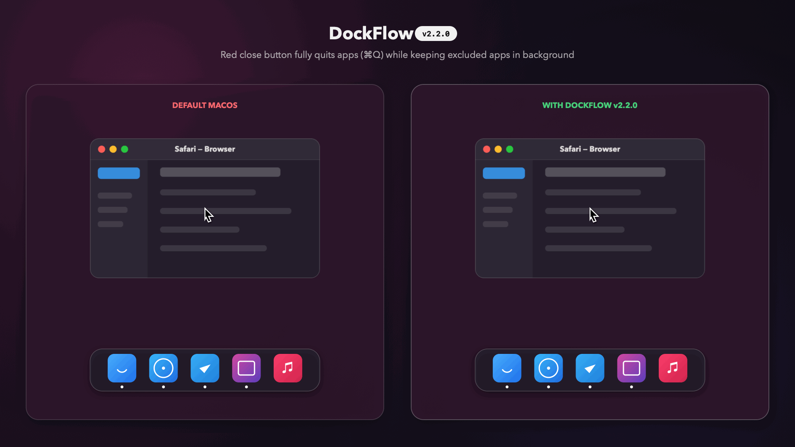

# 🌊 DockFlow for macOS

> **Smooth Dock management, smart window closing (⌘Q), and native macOS gestures.**  
> *Genie effect on Dock click, complete quit on close button with session preservation, middle-click gestures, exclusions whitelist, and Force Touch haptic feedback.*

  
  
  
  
  
  

---

  <a href="README.md"><b>🇷🇺 Русский</b></a> &nbsp;&nbsp;&nbsp;&nbsp; | &nbsp;&nbsp;&nbsp;&nbsp; <b>🇺🇸 English</b>

---

  

  

  

    
<b>📸 Screenshots: Settings Window & Exclusions Sheet (Click to expand)</b>

     
    

      
      &nbsp;&nbsp;&nbsp;&nbsp;
      
    

  

> 🔱 **Attribution & Vibecoding:**  
> **DockFlow** is an advanced fork of **[DockMinimizer](https://github.com/JackTonyMa/DockMinimizer)** by *JackTonyMa*.  
> Created and maintained by **[@minosssh1](https://github.com/minosssh1)** through **vibecoding** in pair with AI assistant **Antigravity** (Google DeepMind).  
> This fork significantly revamps window behaviors, adds hardware-accelerated Genie animations, zero-window auto-termination via CoreGraphics, an app exclusions whitelist, Middle-Click gestures, Force Touch haptic feedback, zero idle CPU usage (0.0%), session preservation, and a clean macOS 27 aesthetic.

---

### 📌 Why DockFlow?

Standard macOS has window management behaviors that can feel counter-intuitive (especially for users coming from Windows or Linux):
1. **Clicking a Dock icon doesn't minimize:** If an app is already active, clicking its Dock icon does nothing.
2. **The red close button doesn't quit apps:** Clicking the close button closes the window, but leaves the background process idling in memory and showing a dot in the Dock, requiring an extra `⌘ + Q`.
3. **Messengers & music:** You usually want to quit heavy apps like browsers completely, but keep Telegram or Spotify running in the background.

**DockFlow** seamlessly solves these pain points natively without draining battery life (**0.0% idle CPU**).

---

### 🚀 Key Features

| Feature | Description |
|---|---|
| 🪄 **Genie Effect** | Clicking an active app icon in the Dock smoothly minimizes it with Genie animation; clicking again restores it. |
| ❌ **Quit on Close (⌘Q)** | Clicking the red close button on the last window completely terminates the app like `Command + Q`. |
| 🛡️ **Exclusions Whitelist** | Telegram, Discord, Spotify, Music, or any custom app stay running in the background. |
| 🖱️ **Middle-Click on Dock** | Middle-clicking a Dock icon opens a **New Window (⌘N)**, quits (⌘Q), or hides the app. |
| 📳 **Haptic Feedback** | Tactile vibration on Force Touch / Magic Trackpad when minimizing and closing windows. |
| 🌐 **Multilingual** | Fully localized interface: English, Русский, 简体中文, and Українська. |
| 🔋 **0.0% Idle CPU** | Pure reactive architecture with zero background polling loops — saves battery with native App Nap. |
| 💾 **Preserves Tabs** | Web browsers (Safari, Chrome, etc.) keep open tabs and session states when closed via close button. |
| 🔄 **OTA Auto-Updater** | Built-in lightweight updater in menu bar with real-time download progress. |

---

### 📦 Installation

1. Download **`DockFlow-Installer.dmg`** from the [Releases](https://github.com/minosssh1/DockFlow/releases) page.
2. Open the DMG and drag **DockFlow** into your **Applications** folder.
3. Launch the app.
4. Grant the required permission at:  
   `System Settings → Privacy & Security → Accessibility`.

---

### 📄 License & Credits

- **Original project:** Copyright © 2025 **[JackTonyMa](https://github.com/JackTonyMa)** (DockMinimizer).
- **DockFlow enhancements:** Copyright © 2026 **[minosssh1](https://github.com/minosssh1)**.
- **Development & Vibecoding:** Created in pair with **Antigravity** (Google DeepMind).
- Distributed under the open-source **MIT License**.
